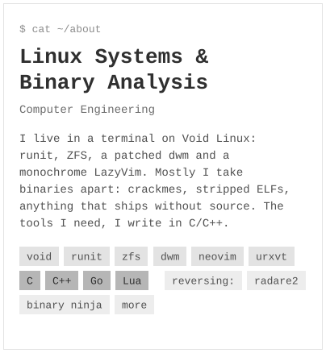
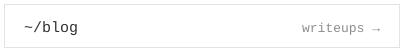
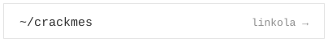
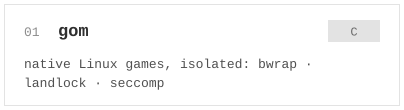
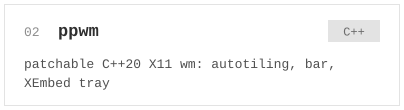
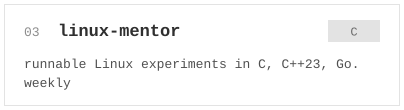
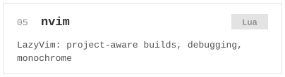
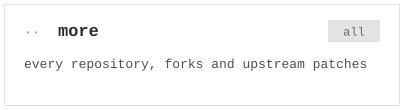

<picture><source media="(prefers-color-scheme: dark)" srcset="assets/hero-dark.77e8c482.svg"></picture>

<picture><source media="(prefers-color-scheme: dark)" srcset="assets/about-dark.249dedaa.svg"></picture> <picture><source media="(prefers-color-scheme: dark)" srcset="assets/trace-dark.227940c6.svg"></picture>

<a href="https://bedeaf.pages.dev/"><picture><source media="(prefers-color-scheme: dark)" srcset="assets/blog-dark.40f8cc6d.svg"></picture></a> <a href="https://crackmes.one/user/linkola"><picture><source media="(prefers-color-scheme: dark)" srcset="assets/crackmes-dark.70d1f19d.svg"></picture></a>

<picture><source media="(prefers-color-scheme: dark)" srcset="assets/projects-dark.65e9761d.svg"></picture>

<a href="https://github.com/bedeaf/gom"><picture><source media="(prefers-color-scheme: dark)" srcset="assets/p-gom-dark.4a7fe4da.svg"></picture></a> <a href="https://github.com/bedeaf/ppwm"><picture><source media="(prefers-color-scheme: dark)" srcset="assets/p-ppwm-dark.3b3d3abc.svg"></picture></a> <a href="https://github.com/bedeaf/linux-mentor"><picture><source media="(prefers-color-scheme: dark)" srcset="assets/p-linux-mentor-dark.37fee1d6.svg"></picture></a> <a href="https://github.com/bedeaf/void-config"><picture><source media="(prefers-color-scheme: dark)" srcset="assets/p-void-config-dark.29ef4056.svg"></picture></a> <a href="https://github.com/bedeaf/nvim"><picture><source media="(prefers-color-scheme: dark)" srcset="assets/p-nvim-dark.5c605fe7.svg"></picture></a> <a href="https://github.com/bedeaf?tab=repositories"><picture><source media="(prefers-color-scheme: dark)" srcset="assets/more-dark.410fe4b9.svg"></picture></a>

<picture><source media="(prefers-color-scheme: dark)" srcset="assets/activity-dark.3bd0a913.svg"></picture>

<picture><source media="(prefers-color-scheme: dark)" srcset="../output/snake-dark.svg"></picture>

<picture><source media="(prefers-color-scheme: dark)" srcset="https://github-readme-activity-graph.vercel.app/graph?username=bedeaf&area=true&hide_border=true&radius=6&bg_color=00000000&color=ffffff60&line=ffffffa0&point=ffffffcf&area_color=ffffff40"></picture>

