
<picture><source media="(prefers-color-scheme: dark)" srcset="assets/hero-dark.02085777.svg"></picture>

<picture><source media="(prefers-color-scheme: dark)" srcset="assets/about-dark.7fd5300b.svg">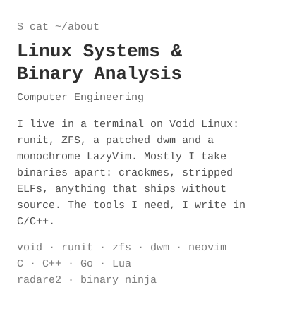</picture> <picture><source media="(prefers-color-scheme: dark)" srcset="assets/trace-dark.dece475d.svg"></picture>

<a href="https://bedeaf.pages.dev/"><picture><source media="(prefers-color-scheme: dark)" srcset="assets/blog-dark.be52849b.svg"></picture></a> <a href="https://crackmes.one/user/linkola"><picture><source media="(prefers-color-scheme: dark)" srcset="assets/crackmes-dark.99354046.svg"></picture></a>

<picture><source media="(prefers-color-scheme: dark)" srcset="assets/projects-dark.f87c8c8b.svg"></picture>

<a href="https://github.com/bedeaf/gom"><picture><source media="(prefers-color-scheme: dark)" srcset="assets/p-gom-dark.468b659e.svg">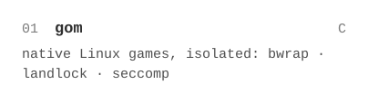</picture></a> <a href="https://github.com/bedeaf/ppwm"><picture><source media="(prefers-color-scheme: dark)" srcset="assets/p-ppwm-dark.58e79411.svg"></picture></a> <a href="https://github.com/bedeaf/linux-mentor"><picture><source media="(prefers-color-scheme: dark)" srcset="assets/p-linux-mentor-dark.cc08b7b5.svg"></picture></a> <a href="https://github.com/bedeaf/void-config"><picture><source media="(prefers-color-scheme: dark)" srcset="assets/p-void-config-dark.d305097f.svg">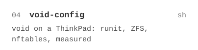</picture></a> <a href="https://github.com/bedeaf/nvim"><picture><source media="(prefers-color-scheme: dark)" srcset="assets/p-nvim-dark.5003d11c.svg">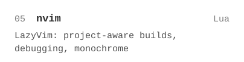</picture></a>

<picture><source media="(prefers-color-scheme: dark)" srcset="assets/upstream-dark.e3cf650a.svg"></picture>

<a href="https://github.com/radareorg/r2ghidra/pull/312"><picture><source media="(prefers-color-scheme: dark)" srcset="assets/pr-r2ghidra-312-dark.c322fe19.svg">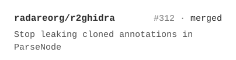</picture></a> <a href="https://github.com/radareorg/radare2/pull/27557"><picture><source media="(prefers-color-scheme: dark)" srcset="assets/pr-radare2-27557-dark.895a5cd9.svg">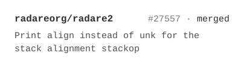</picture></a> <a href="https://github.com/radareorg/radare2/pull/27518"><picture><source media="(prefers-color-scheme: dark)" srcset="assets/pr-radare2-27518-dark.15b89949.svg">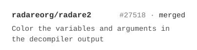</picture></a> <a href="https://github.com/yshui/picom/pull/1561"><picture><source media="(prefers-color-scheme: dark)" srcset="assets/pr-picom-1561-dark.4d6e3678.svg">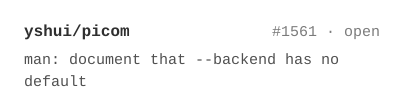</picture></a> <a href="https://github.com/yshui/picom/pull/1560"><picture><source media="(prefers-color-scheme: dark)" srcset="assets/pr-picom-1560-dark.1ad684f3.svg">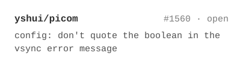</picture></a> <a href="https://github.com/radareorg/radare2/pull/27558"><picture><source media="(prefers-color-scheme: dark)" srcset="assets/pr-radare2-27558-dark.15bc44a9.svg">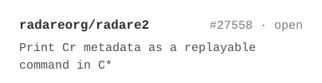</picture></a> <a href="https://github.com/radareorg/radare2/pull/27519"><picture><source media="(prefers-color-scheme: dark)" srcset="assets/pr-radare2-27519-dark.c59c5c4e.svg">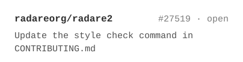</picture></a>

<picture><source media="(prefers-color-scheme: dark)" srcset="assets/activity-dark.67da10b1.svg"></picture>

<picture><source media="(prefers-color-scheme: dark)" srcset="../output/snake-dark.svg"></picture>

