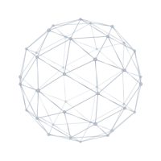

<p align="center">
  
</p>



### Linux Systems &<br>Network Engineering

Computer Engineering.

I live in a terminal on Void Linux: runit, ZFS, a patched dwm and a monochrome LazyVim.
I build sandboxes, window managers and small sharp tools in C/C++ and spend the rest of the time inside Linux internals, networking and disassemblers.

<p>
  <a href="https://blog.linkola.workers.dev/"></a>
  <a href="#"></a>
</p>

<p>
  
  
  
  
  
  
  
</p>

<br clear="right">

```
~/projects
```

| | |
|:--|:--|
| **[gom](https://github.com/merthium/gom)** | play untrusted native Linux games in a layered sandbox: bubblewrap · gamescope · Landlock · seccomp |
| **[ppwm](https://github.com/merthium/ppwm)** | minimal patchable C++20 X11 window manager: autotiling, periodic bar, XEmbed tray |
| **[linux-mentor](https://github.com/merthium/linux-mentor)** | small runnable Linux experiments in C, C++23 and Go, a new chapter every week |
| **[void-config](https://github.com/merthium/void-config)** | Void on a ThinkPad: runit, ZFS, dwm, DNSCrypt, nftables, every number measured |
| **[nvim](https://github.com/merthium/nvim)** | LazyVim with project-aware builds, debugging and the monochrome UI you see above |

```
~/activity
```

<picture>
  <source media="(prefers-color-scheme: dark)" srcset="https://raw.githubusercontent.com/merthium/merthium/output/snake-dark.svg">
  
</picture>


