  

### Linux Systems & Network Engineering

Computer engineering student.

Void Linux, DWM and LazyVim are my daily setup. I'm learning C/C++, Linux internals and computer networking.

  
  
  
  
  
  

 

#### ▍ Projects

| | |
|---|---|
| **[gom](https://github.com/merthium/gom)** | Play untrusted native Linux games in a layered sandbox — bubblewrap, gamescope, Landlock, seccomp. |
| **[ppwm](https://github.com/merthium/ppwm)** | Minimal patchable C++20 X11 window manager with autotiling and XEmbed tray. |
| **[linux-mentor](https://github.com/merthium/linux-mentor)** | Small, runnable Linux experiments in C, C++23 and Go. A new chapter every week. |
| **[void-config](https://github.com/merthium/void-config)** | Void on a ThinkPad: runit, ZFS, dwm, DNSCrypt, nftables, measured. |

#### ▍ Activity

<picture>
  <source media="(prefers-color-scheme: dark)" srcset="https://raw.githubusercontent.com/merthium/merthium/output/snake-dark.svg">
  
</picture>

  <picture>
    <source media="(prefers-color-scheme: dark)" srcset="https://github-readme-activity-graph.vercel.app/graph?username=merthium&bg_color=0d1117&color=c9d1d9&line=f0f0f0&point=ffffff&area=true&area_color=8a8a8a&hide_border=true">
    
  </picture>

