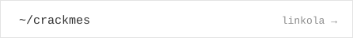
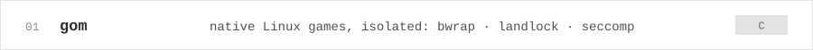
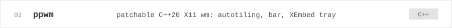

<picture><source media="(prefers-color-scheme: dark)" srcset="assets/hero-dark.f4184e54.svg"></picture>

<picture><source media="(prefers-color-scheme: dark)" srcset="assets/about-dark.7524119b.svg"></picture>

<a href="https://bedeaf.pages.dev/"><picture><source media="(prefers-color-scheme: dark)" srcset="assets/blog-dark.59f51fd4.svg"></picture></a> <a href="https://crackmes.one/user/linkola"><picture><source media="(prefers-color-scheme: dark)" srcset="assets/crackmes-dark.c6512346.svg"></picture></a>

<picture><source media="(prefers-color-scheme: dark)" srcset="assets/projects-dark.6fd6435c.svg"></picture>

<a href="https://github.com/merthium/gom"><picture><source media="(prefers-color-scheme: dark)" srcset="assets/p-gom-dark.4bed6354.svg"></picture></a>

<a href="https://github.com/merthium/ppwm"><picture><source media="(prefers-color-scheme: dark)" srcset="assets/p-ppwm-dark.af1ce8fa.svg"></picture></a>

<a href="https://github.com/merthium/linux-mentor"><picture><source media="(prefers-color-scheme: dark)" srcset="assets/p-linux-mentor-dark.be4e4a18.svg"></picture></a>

<a href="https://github.com/merthium/void-config"><picture><source media="(prefers-color-scheme: dark)" srcset="assets/p-void-config-dark.51b868b2.svg"></picture></a>

<a href="https://github.com/merthium/nvim"><picture><source media="(prefers-color-scheme: dark)" srcset="assets/p-nvim-dark.a7ca6c55.svg"></picture></a>

<picture><source media="(prefers-color-scheme: dark)" srcset="assets/activity-dark.975ad93c.svg"></picture>

<picture><source media="(prefers-color-scheme: dark)" srcset="../output/snake-dark.svg"></picture>

<picture><source media="(prefers-color-scheme: dark)" srcset="https://github-readme-activity-graph.vercel.app/graph?username=bedeaf&area=true&hide_border=true&radius=6&bg_color=00000000&color=ffffff60&line=ffffffa0&point=ffffffcf&area_color=ffffff40"></picture>

